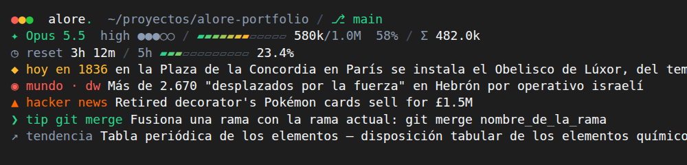

# claude-statusline

Status line para Claude Code con la paleta de [alore.dev](https://alore.dev) y una línea que cambia en cada mensaje: noticias del mundo, hoy en la historia, tips de comandos que tienes instalados, tendencias de Wikipedia y Hacker News. Todo se consulta en vivo, no hay una lista fija que se acabe.



> La preview muestra un dato de cada fuente; en la terminal sale **uno** que cambia cada vez que envías un mensaje.

## Qué muestra

| Línea | Contenido |
|---|---|
| 1 | `●●●` · `alore.` · directorio · `⎇ rama` (cmd/ctrl+click abre el repo en el navegador) · worktree |
| 2 | `✦ modelo` · effort `●●●○○` · contexto `▰▰▰▱▱` usados/total % · `Σ` tokens totales |
| 3 | `◷ reset` del límite de 5h · barra de uso (solo con suscripción) |
| 4 | Dato del momento (ver fuentes); cmd/ctrl+click abre el artículo completo |

Las barras pasan de verde a amarillo a rojo según se llenan.

### Fuentes de la línea 4

| Icono | Fuente | Se refresca |
|---|---|---|
| `◉ mundo` | Titulares principales de BBC Mundo, DW y France 24 (español) | cada 30 min |
| `◆ hoy en AAAA` | Wikipedia ES, "un día como hoy" (eventos) | diario |
| `❯ tip` | Ejemplos de [tldr-pages](https://github.com/tldr-pages/tldr) en español, **solo de comandos instalados en tu máquina** | semanal |
| `↗ tendencia` | Artículos más leídos hoy en Wikipedia ES | diario |
| `▲ hacker news` | Top 30 de Hacker News | cada hora |

Las respuestas se guardan en `~/.cache/claude-statusline/`, así que casi todos los mensajes eligen al azar de la caché sin hacer peticiones. Si una fuente falla se usa otra; si fallan todas se queda el dato anterior y el error queda en `~/.cache/claude-statusline/fact.log`.

## Instalar

Requisitos: `bash`, `jq`, `curl`, `awk`, `unzip`, `git`. Funciona en Linux y macOS.

```bash
gh repo clone AloreBB/claude-statusline /tmp/claude-statusline
bash /tmp/claude-statusline/install.sh
```

El instalador:

1. Copia `statusline.sh` y `statusline-fact.sh` a `~/.claude/`.
2. Hace backup de `~/.claude/settings.json` (`settings.json.bak-<fecha>`).
3. Pone `statusLine` apuntando al script (refresca cada 30 s).
4. Agrega un hook `UserPromptSubmit` que cambia el dato en cada mensaje (corre en background, no frena el envío). No toca tus otros hooks.
5. Trae el primer dato.

Se puede correr de nuevo para actualizar; no duplica el hook.

### Desinstalar

```bash
bash /tmp/claude-statusline/install.sh --uninstall
```

Quita `statusLine`, el hook, los scripts y la caché. Deja backup del settings.

## Para Claude Code

Si te pasaron la URL de este repo para instalarlo:

1. Clona con `gh repo clone AloreBB/claude-statusline /tmp/claude-statusline` (es privado, usa `gh`, no WebFetch). Si ya existe, haz `git -C /tmp/claude-statusline pull`.
2. Si falta alguna dependencia (`jq`, `curl`, `unzip`), dile al usuario cuál y cómo instalarla; no la instales sin preguntar.
3. Corre `bash /tmp/claude-statusline/install.sh` y muestra su salida.
4. Si el settings tenía otro `statusLine` (por ejemplo `npx ccstatusline`), avisa que fue reemplazado. Si era ccstatusline, ofrece borrar `~/.config/ccstatusline` y desinstalarlo (`npm uninstall -g ccstatusline`).
5. Comprueba: `echo '{"workspace":{"current_dir":"'"$HOME"'"},"model":{"display_name":"Opus"}}' | bash ~/.claude/statusline.sh` debe imprimir varias líneas sin errores.
6. Si corre dentro de tmux (`$TMUX` definido), revisa `tmux display -p '#{client_termfeatures}'`: si no incluye `hyperlinks`, ofrece agregar `set -as terminal-features ',*:hyperlinks'` a `~/.tmux.conf` (sin eso tmux descarta los enlaces). Aplica con `tmux set -as terminal-features ',*:hyperlinks'` y avisa que hay que desconectarse y volver a hacer attach.
7. Dile al usuario que se ve en el próximo refresh o al reiniciar Claude Code.

## Notas

- Los iconos son Unicode estándar (`● ▰ ▱ ✦ ◷ ◆ ◉ ▲ ❯`), no glifos powerline, así que no hace falta Nerd Font.
- Los enlaces (rama y dato) usan OSC 8: funcionan en iTerm2, Ghostty, WezTerm, Kitty, VS Code y Terminal.app reciente. **En tmux** hay que habilitarlos con `set -as terminal-features ',*:hyperlinks'` en `~/.tmux.conf` (tmux ≥ 3.4) y volver a hacer attach.
- Usa color truecolor (24 bits). Terminales sin truecolor muestran colores aproximados.
- La paleta está al inicio de `statusline.sh` (`SIGNAL`, `SLATE`, `AMBER`…), por si quieres cambiarla. El texto principal usa el color por defecto de la terminal, así que se lee en temas claros y oscuros.
